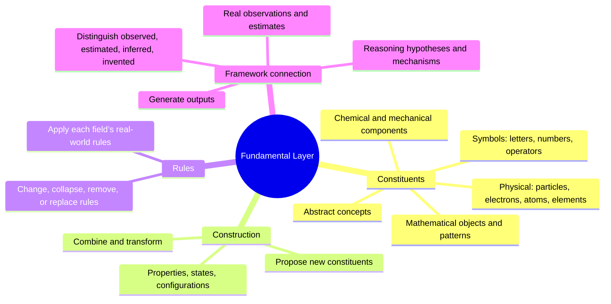

# Journey 001 — Fundamental Building Blocks

**Status:** Conceptual purpose refined; implementation scope must be re-evaluated against this broader purpose.
**History:** This document extends the original character/token implementation plan. The existing implementation remains a useful human-readable construction path; it is not the full definition of this layer.

## Core purpose

Establish and expand the fundamental units, distinctions, properties, states, and possible configurations from which the system can represent, construct, inspect, and creatively explore things across domains—including things not explicitly predefined.

This layer is not fundamentally a character recognizer or a dictionary of known objects. It is the foundation for construction itself. It should support reusable primitives and permit new primitives or representations to be introduced when the existing ones cannot adequately express a construction.

## Scope of constructions

The layer should be capable of representing or supplying building blocks for, at minimum:

- **Physical:** matter, energy, fields, spatial configurations, and physical systems.
- **Chemical:** elements, atoms, bonds, molecules, compounds, and reaction participants.
- **Mathematical and quantitative:** quantities, numbers, dimensions, variables, mathematical objects, and operations.
- **Symbolic and representational:** alphabets, characters, digits, notation, diagrams, codes, signals, and other human-readable or machine-readable encodings.
- **Patterns and structures:** repetition, sequences, symmetry, configurations, and reusable arrangements.
- **Abstract and conceptual:** distinctions, properties, qualities, identities, and other abstractions.
- **Imaginary and hypothetical:** invented entities, fictional worlds, counterfactuals, and internally specified impossible or speculative constructions.
- **Relations, processes, and change:** connections, interactions, transformations, and state changes where these are needed to define a construction.

These are domains and candidate categories, not a requirement to create a separate sub-layer for each. They overlap, and experiments should determine which distinctions need explicit representation.

## Human-readable construction is one application

Typing or pasting alphabets, numbers, symbols, and patterns is one way to supply defined components and produce human-understandable constructions. It must not define the limits of the layer.

A construction may be represented internally through typed units, properties, relations, configurations, or other suitable structures, then rendered as text, notation, diagrams, or another output. For example, a chemical structure should not be reduced to the written string of its formula; its elements, bonds, arrangement, and constraints are separate representational aspects.

## First-layer mind map

## Important distinctions

- A **primitive** is relative to the chosen representational system; do not assume one universal smallest unit has already been discovered.
- A **unit**, its **properties**, its **relations**, and a **configuration containing it** are not interchangeable.
- A **symbol** is a representation of something, not necessarily the thing represented.
- A **possible construction in an imagined rule system** is not thereby physically possible or real.
- A **generated candidate** is not validated knowledge. Physical and chemical claims need appropriate constraints and evidence.
- A **new primitive** should be introduced because existing primitives cannot adequately express a demonstrated need—not merely to make the inventory larger.

## Relationship to other architecture parts

- **Formulae:** can organize, combine, and operate on available building blocks.
- **Reasoning formulae:** can derive, compare, test, and revise candidate constructions.
- **Context:** can specify which interpretation, assumptions, constraints, and state apply.
- **Framework:** provides shared relational structure across units, configurations, properties, and other represented items; it is not a sequential stage.
- **Output:** can render a construction in a suitable human-readable or machine-usable form.

These are provisional boundaries to refine as the architecture is examined.

## Original character/token work remains valid

The earlier Python character/token work is retained as one narrow, practical application: use established Python tooling to identify source characters and tokens, record metadata and context, preserve source text, and create human-readable/programmatic constructions. It can test identity, properties, contextual roles, representation, and traceability. It does not exhaust the purpose of Fundamental Building Blocks.

## Questions to resolve

1. Which distinctions must the initial foundation support before domain-specific structures are added?
2. What makes something a primitive in this architecture, and how can the system justify adding a new one?
3. How are units, properties, relations, configurations, and operations represented without collapsing them together?
4. How can one construction have multiple encodings without losing identity or structure?
5. How should physical possibility, fictional rules, mathematical validity, and unconstrained speculation be distinguished?
6. What evidence or validation is required before a generated construction is treated as reliable?
7. Which responsibilities belong here and which should be delegated to Formulae, Reasoning Formulae, Context, or the Framework?
8. What is the smallest test that demonstrates creative construction rather than retrieval or recombination alone?
9. How do we measure representational coverage, novelty, validity, resource cost, and failure modes?
10. What existing implementation should be extended, and what new mechanism is justified only after a concrete need appears?

## Next practical step

Choose a few contrasting examples—a symbolic expression, a chemical structure, a mathematical construction, and an imaginary entity. For each, specify its units, properties, configuration, constraints, and human-readable rendering. Compare what can be shared across examples and what genuinely requires domain-specific representation. Record unresolved questions before adding sub-layers.

Do not claim general creativity or physical validity from representation alone. Test each capability separately.
